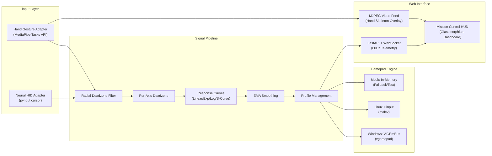

# IntentPad-HID

**Cross-platform Human-Intent & Multi-Modal Input to Virtual Xbox 360 Gamepad Engine**

Transform hand gestures, eye-gaze, and neural HID cursor inputs into precise Xbox 360 gamepad signals with sub-millisecond latency. Built for Windows (ViGEmBus) and Linux (uinput) with a production-grade signal processing pipeline.

## Features

- **Cross-Platform Virtual Controller**: Native Xbox 360 emulation on Windows (ViGEmBus) and Linux (uinput/kernel), with automatic fallback to mock mode
- **Signal Processing Pipeline**: Exponential Moving Average (EMA) smoothing, configurable per-axis deadzones, radial deadzone filtering, and response curves (linear, exponential, logarithmic, S-curve)
- **Game Profiles**: JSON-configurable profiles for GTA driving, FPS tactical, desktop assistive, and custom mappings
- **Modular Input Adapters**:
  - **Hand Gesture**: MediaPipe hand tracking (640x480 @ 20-30+ FPS on CPU) → analog sticks, triggers, buttons
  - **Neural HID**: OS cursor vectors & dwell states (Neuralink N1, eye-gaze trackers) → analog sticks + dwell buttons
- **Mission Control HUD**: Glassmorphism dashboard with live hand skeleton feed, interactive controller visualizer, profile selector, real-time tuning sliders
- **60Hz WebSocket Telemetry**: Live controller state, profile switching, adapter switching, smoothing/sensitivity updates

## System Architecture



## Hardware Prerequisites

### Windows
- **ViGEmBus Driver** (required for physical gamepad emulation)
  - Download from: https://github.com/ViGEm/ViGEmBus/releases
  - Install `ViGEmBus_Setup_x.x.x.exe` and reboot
- Webcam for hand gesture tracking

### Linux
- Kernel with `uinput` module (`modprobe uinput`)
- User in `input` group: `sudo usermod -aG input $USER` (log out/in after)
- `v4l-utils` for webcam: `sudo apt-get install v4l-utils`
- Webcam for hand gesture tracking

### Optional
- Neuralink N1 / eye-gaze tracker for Neural HID adapter

## Quick Start

### Windows (PowerShell)

```powershell
# 1. Install ViGEmBus driver (required for physical gamepad)
# Download from: https://github.com/ViGEm/ViGEmBus/releases

# 2. Clone and install
git clone https://github.com/baatouchehoussem/IntentPad-HID
cd IntentPad-HID
pip install -r requirements.txt

# 3. Run
python -m intentpad.server
```

### Linux (Bash)

```bash
# 1. Install kernel headers and uinput permissions
sudo apt-get update && sudo apt-get install -y linux-headers-$(uname -r) v4l-utils
sudo usermod -aG input $USER
# Log out and back in for group changes

# 2. Clone and install
git clone https://github.com/baatouchehoussem/IntentPad-HID
cd IntentPad-HID
pip install -r requirements.txt

# 3. Run
python -m intentpad.server
```

### Access Mission Control

Open http://localhost:8080 in your browser.

## Hand Gesture Mapping

| Gesture | Output | Description |
|---------|--------|-------------|
| Hand roll (tilt left/right) | Left Stick X | Movement / Strafe |
| Hand pitch (tilt up/down) | Left Stick Y | Movement / Forward-Back |
| Thumb-index pinch distance | Right Trigger (RT) | Accelerate / Fire |
| Closed fist | Left Trigger (LT) | Brake / ADS |
| Open palm | A Button | Jump / Interact |
| Strong pinch (>80%) | RB Button | Sprint / Reload |

## Neural HID Mapping

| Input | Output |
|-------|--------|
| Cursor X offset from center | Left Stick X |
| Cursor Y offset from center | Left Stick Y (inverted) |
| Dwell (800ms default) | Y Button |
| Left click | Right Trigger (RT) |
| Right click | Left Trigger (LT) |

## Game Profiles

### GTA Driving (`gta_driving`)
- Exponential curves for smooth steering
- Responsive triggers for acceleration/braking
- Moderate right stick for camera control
- Radial deadzone: 0.10

### FPS Tactical (`fps_tactical`)
- Linear movement, exponential aim curves
- Minimal deadzones for precision
- Fast EMA for quick target acquisition
- Radial deadzone: 0.05

### Desktop Assistive (`desktop_assistive`)
- Logarithmic curves for gentle control
- Large deadzones for stability
- High smoothing for tremor reduction
- Radial deadzone: 0.20

## Configuration

### Signal Tuning (via HUD or API)

```json
{
  "smoothing": { "lx": 0.25, "ly": 0.25, "rx": 0.15, "ry": 0.15 },
  "deadzones": { "lx": 0.15, "ly": 0.15, "rx": 0.05, "ry": 0.05, "lt": 0.05, "rt": 0.05 },
  "radial_deadzones": { "lx": 0.1, "ly": 0.1, "rx": 0.1, "ry": 0.1 },
  "sensitivity": { "lx": 1.0, "ly": 1.0, "rx": 1.2, "ry": 1.2, "lt": 1.0, "rt": 1.0 },
  "curves": { "lx": "exponential", "ly": "exponential", "rx": "exponential", "ry": "exponential" }
}
```

### Custom Profiles

Create `profiles/my_profile.json`:

```json
{
  "name": "my_profile",
  "description": "Custom racing profile",
  "axis_configs": {
    "lx": { "deadzone": 0.1, "sensitivity": 1.1, "curve": "exponential", "ema_alpha": 0.2, "radial_deadzone": 0.1 }
  },
  "trigger_configs": {
    "rt": { "deadzone": 0.02, "curve": "linear" }
  },
  "gesture_map": { "steer": "lx", "accelerate": "rt", "brake": "lt" }
}
```

## API Endpoints

| Endpoint | Method | Description |
|----------|--------|-------------|
| `/ws/telemetry` | WS | 60Hz live state, config updates |
| `/video_feed` | GET | MJPEG hand skeleton stream |
| `/health` | GET | Health check |
| `/status` | GET | Server status, available profiles/adapters |
| `/api/config` | POST | Update smoothing/deadzone/sensitivity/curves |
| `/api/profile/{name}` | POST | Switch active profile |
| `/api/adapter/{name}` | POST | Switch input adapter |

## Development

```bash
# Install dev dependencies
pip install -r requirements.txt

# Run tests
pytest tests/ -v

# Lint
ruff check src/ tests/

# Type check
mypy src/
```

## Project Structure

```
IntentPad-HID/
├── src/intentpad/
│   ├── server.py          # FastAPI + WebSocket server
│   ├── gamepad_engine.py  # Cross-platform virtual gamepad (ViGEmBus/uinput/Mock)
│   ├── pipeline.py        # Signal processing (EMA, deadzone, curves, radial deadzone)
│   ├── profiles.py        # Profile management & persistence
│   └── adapters/
│       ├── base.py        # Abstract InputAdapter base class
│       ├── hand_gesture.py # MediaPipe hand tracking (threaded capture)
│       └── neural_hid.py  # Neural HID / cursor adapter
├── web/
│   └── index.html         # Mission Control HUD (glassmorphism)
├── tests/
│   └── test_pipeline.py   # Unit & integration tests
├── requirements.txt       # Minimal dependencies
├── pyproject.toml         # Build config
└── README.md
```

## Performance Targets

| Metric | Target |
|--------|--------|
| End-to-end latency | < 16ms (60Hz) |
| Hand tracking FPS (CPU) | 20-30+ FPS @ 640x480 |
| WebSocket telemetry rate | 60 Hz |
| MJPEG stream quality | 70% JPEG @ 30 FPS |

## License

MIT License - see [LICENSE](LICENSE)

## Credits

- [ViGEmBus](https://github.com/ViGEm/ViGEmBus) - Windows virtual gamepad
- [evdev](https://github.com/gvalkov/python-evdev) - Linux uinput bindings
- [MediaPipe](https://mediapipe.dev/) - Hand tracking (Tasks API)
- [FastAPI](https://fastapi.tiangolo.com/) - Web framework